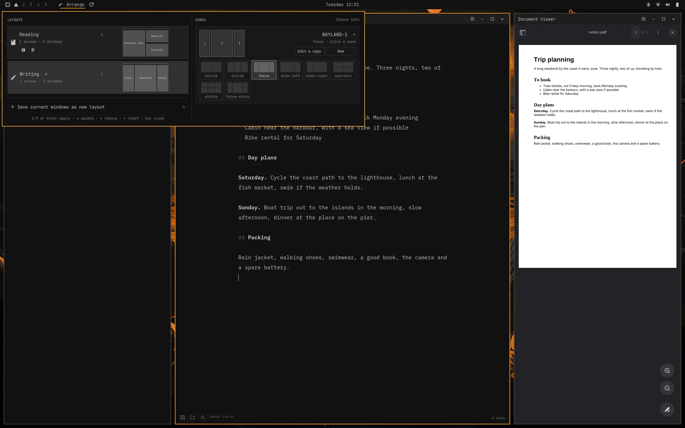
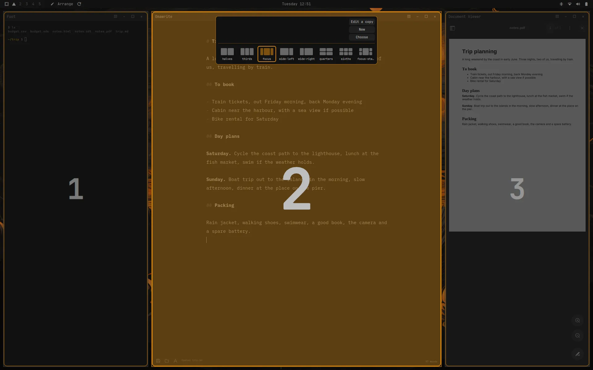
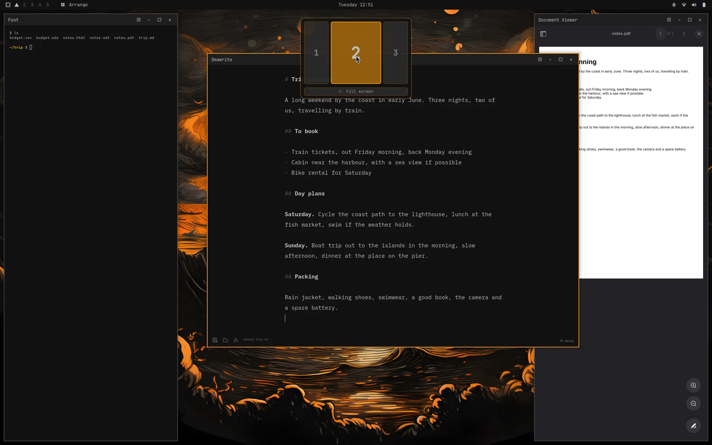
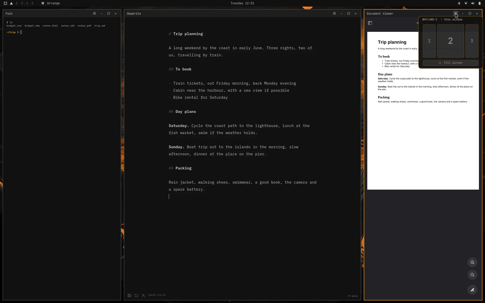
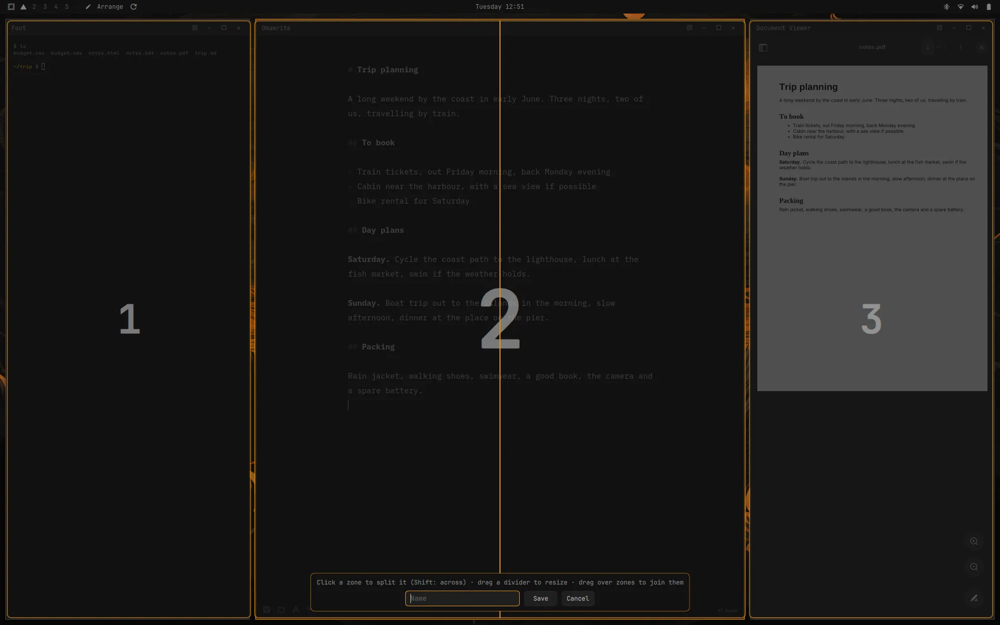

# omext arrange

Part of [**omarchy-extended**](https://github.com/omarchy-extended): addons for [Omarchy](https://omarchy.org).

Window layouts and snap zones for Omarchy. Save how your windows sit across all
your screens and get it back in one click. And snap floating windows into zones
of a screen: halves, thirds, a wide middle, or sets you draw yourself.



## Layouts

- **Save** the visible workspaces on every screen as a layout: each window's
  place, each workspace's Omarchy layout (floating, dwindle or scrolling), and
  each screen's zone set.
- **Apply** a layout: the windows go back where they were. Apps that aren't
  running are started first. Floating windows go back into their zones; tiled
  workspaces get their split back.
  Windows that aren't in the layout are put away. An app of an
  [omext dock](https://github.com/omarchy-extended/docks) goes back into its
  dock (so a layout saved with it docked has it docked again). On a floating workspace
  each of the rest is made to fit its screen (one larger than the screen fills it, one
  hanging off an edge moves back on) and minimized, a click from back; on a
  tiled one they go to a spare workspace. A layout's own window that comes
  out larger than its screen fills it.
- **Reset** puts the current layout back after you've moved things around.
  **Update** saves over it.
- Each layout has a bar icon, and can have a keyboard shortcut:
  `omext-layout key <id> "SUPER + ALT + 1"`.
- With [omext docks](https://github.com/omarchy-extended/docks) installed,
  a window that's in a dock is taken out of it when a layout wants it.

## Zones

- **Each screen has a zone set**: halves, thirds, focus (a wide middle),
  wide left or right, quarters, sixths, focus stack, or one of your own. By
  default wide screens get thirds and others halves.
- **The zone picker** (Super + Z): an overlay of the screen's zones. Click a zone
  to snap the window there, or drag across several to span them. Keys 1–9 snap
  too. The row at the top switches the screen's set, and the editor draws new
  ones.
- **Super + Shift + arrows** move a floating window to the next zone, and onto
  the next screen at the edge. On a tiled window they still swap, as in Omarchy.
- **A snap bar** shows while you drag a floating window: drop it on a zone, or
  on Fill screen.
  Drop it on the line between two zones and it covers both; where several
  meet, all of them. The titlebar's map takes a click the same way.
- **Hold Shift, then drag** and the zones show over the whole screen, each
  where it is, in place of the bar: drop the window where it's to go (on a line
  between zones, across them; on a dock's strip along its edge, into the dock).
  Let go of Shift before the button and the snap is off. (Shift goes down
  before the drag starts: Hyprland lets go of a dragged window at any key.)
- A dragged window is dropped when the button is let go of, not while it's
  held still.
- **A ▦ titlebar button** on floating windows opens a small map of the zones at
  the pointer.
- **With [omext docks](https://github.com/omarchy-extended/docks):** the snap
  bar and the ▦ map show each screen's docks beside its zones, on the side
  they're on. Drop the window there (or click it) and it goes into that dock.
- **Magnet:** a dragged floating window snaps against screen edges and other
  windows, keeping the gaps.
- **Gaps:** zones follow Omarchy's gaps and borders, so snapped windows line up
  the way tiled ones do (titlebar included). With gaps off they sit edge to edge.









An app with a minimum size larger than its zone stays at that size and runs
into the next zone (Omawrite won't go below 720 pixels wide, a third of a
1920-pixel screen is about 620). Give such apps a wider zone, or span two.

## The Arrange bar widget

One menu for both: your layouts with a preview of every screen (click one, or
press its number, to apply it), Save and Update, and each screen's zones (click
a zone to put the active window there, or pick another set).

## Arrange screens

The panel's "Arrange screens" (or `s`) shows the connected screens as boxes.
Drag one next to another: it lands beside the nearest, its edges in line with
that one's when they are close, and never over another. Tab chooses a screen
and the arrows move it; Enter applies, Esc leaves.

The arrangement is kept for that set of screens (the laptop with the big
screen at work is one set, the laptop with another screen at home another)
and is in force again whenever that set is connected. Each screen keeps its
resolution, scale and rotation. It is given to Hyprland after your own
`monitors.lua`; the panel's forget button, or `omext-screens reset`, hands the
screens back to that.

## Windows come back where they were

A floating window that closes leaves its place behind for its app, and the
app's next window opens there:

- in the zone (or zones) it filled, if the screen's zones still have that
  number;
- else where it stood, floating. A window you placed by hand comes back to
  that spot and size.

Only the first window of an app goes back; a second one, opened while the
first is up, is placed as any new window. Places are kept per set of screens
(the laptop alone, the laptop and a big screen), so a window never comes back
on a screen that isn't there. Windows in an
[omext dock](https://github.com/omarchy-extended/docks) are the dock's.

To turn it off:

```bash
omext-settings set zones-settings remember false
```

## Layouts that apply by themselves

A layout can be its screens' own: turn that on (the screen button on its row
in the panel, or `a`), and it is applied whenever exactly the screens it was
saved with are the ones connected. Plug the big screen in and the windows go
back to their places there; unplug it and the laptop's layout takes over. Also
at login.

- One layout per set of screens: turning it on for one turns it off for another
  saved with the same screens.
- Applied this way nothing is started; only the windows that are open are
  arranged.
- From a script: `omext-layout auto <id> on|off|toggle`.

## Compatibility

Needs **Omarchy 4.5** or later (tested on 4.5.0): it builds on its floating
workspaces, titlebars and shell plugins.

Made for, and tested on, Omarchy's **floating** workspace layout:

```bash
omarchy hyprland workspace layout default floating
```

Layouts also save and restore dwindle and scrolling workspaces, but those
layouts are less tested, and nothing is guaranteed there.

Arrange takes over **Super + Z** and **Super + Shift + arrows** (the latter
only for floating windows), and turns on Hyprland's window snapping.

## Install

You need Omarchy 4.5 or later, with `python`.

```bash
git clone https://github.com/omarchy-extended/arrange.git ~/.local/share/omext-arrange
~/.local/share/omext-arrange/install.sh
```

The install links the files from the clone, so `git pull` there updates it. It:

- links `omext-layout` and `omext-zone` into `~/.local/bin`;
- links the shell plugins `omext.arrange` (the bar widget) and `omext.zones`
  (the zone picker) into `~/.config/omarchy/plugins`, and turns them on;
- adds a marked block to `~/.config/hypr/hyprland.lua`, which loads `hypr/*.lua`
  (the keys, the titlebar button, the snap bar and the magnet).

`./uninstall.sh` removes all of this. Your layouts and zone sets stay in
`~/.config/omext/`.

## Files

| Path | What it is |
|------|------------|
| `bin/omext-layout` | Saves, lists, applies and removes layouts (`omext-layout --help`). |
| `bin/omext-zone` | Zone sets, snapping and the picker (`omext-zone --help`). |
| `plugins/omext.arrange/` | The Arrange bar widget. |
| `plugins/omext.zones/` | The zone picker, editor and snap bar. |
| `hypr/*.lua` | Keys, the titlebar button, the drag watcher and the magnet. |
| `install.sh`, `uninstall.sh` | The standalone install. |
| `~/.config/omext/layouts/` | Your layouts (`OMEXT_LAYOUTS_DIR` overrides it). |
| `~/.config/omext/zones.json` | Each screen's zone set; `zone-sets.json` and `zone-hidden.json` beside it (`OMEXT_ZONES_FILE` overrides). |

## License

MIT
